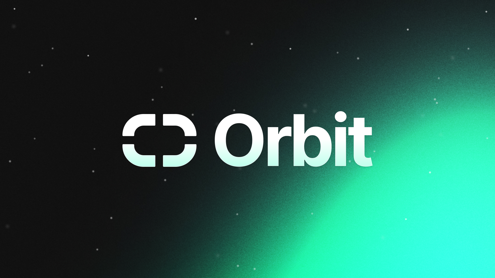

  

**Orbit.js** is an API toolkit and incubator for NATS functionality, providing
specialized utilities that extend the NATS JavaScript ecosystem. Each module
offers higher-level abstractions and productivity tools that, if proven popular
and stable, may eventually migrate to become first-class APIs in the core NATS
clients.

This toolkit serves as a proving ground for innovative messaging patterns and
advanced features, allowing developers to experiment with cutting-edge NATS
capabilities.

# Utilities

Each module is versioned and released on its own, to JSR and npm. An
`incubating` module's API may still change between releases; a `stable` one
follows semver.

<!-- modules:start -->

| Module                                        | Description                                            | Status     | Version                                                                                                                   |
| --------------------------------------------- | ------------------------------------------------------ | ---------- | ------------------------------------------------------------------------------------------------------------------------- |
| [Counters](counters/README.md)                | Distributed counters built on JetStream streams        | incubating | [![JSR][counters-jsr-image]][counters-jsr-url] [![npm][counters-npm-image]][counters-npm-url]                             |
| [Fast Ingest](fastingest/README.md)           | High-throughput batch publish to JetStream             | incubating | [![JSR][fastingest-jsr-image]][fastingest-jsr-url] [![npm][fastingest-npm-image]][fastingest-npm-url]                     |
| [Message Pipeline](messagepipeline/README.md) | Middleware transformations for NATS messages           | stable     | [![JSR][messagepipeline-jsr-image]][messagepipeline-jsr-url] [![npm][messagepipeline-npm-image]][messagepipeline-npm-url] |
| [MuxSub](muxsub/README.md)                    | Many handlers sharing one inbox subscription           | stable     | [![JSR][muxsub-jsr-image]][muxsub-jsr-url] [![npm][muxsub-npm-image]][muxsub-npm-url]                                     |
| [NHGC](nhgc/README.md)                        | Client for KV and messaging over the NATS HTTP Gateway | incubating | [![JSR][nhgc-jsr-image]][nhgc-jsr-url]                                                                                    |

[counters-jsr-url]: https://jsr.io/@synadiaorbit/counters/doc
[counters-jsr-image]: https://jsr.io/badges/@synadiaorbit/counters
[counters-npm-url]: https://www.npmjs.com/package/@synadiaorbit/counters
[counters-npm-image]: https://img.shields.io/npm/v/%40synadiaorbit%2Fcounters
[fastingest-jsr-url]: https://jsr.io/@synadiaorbit/fastingest/doc
[fastingest-jsr-image]: https://jsr.io/badges/@synadiaorbit/fastingest
[fastingest-npm-url]: https://www.npmjs.com/package/@synadiaorbit/fastingest
[fastingest-npm-image]: https://img.shields.io/npm/v/%40synadiaorbit%2Ffastingest
[messagepipeline-jsr-url]: https://jsr.io/@synadiaorbit/messagepipeline/doc
[messagepipeline-jsr-image]: https://jsr.io/badges/@synadiaorbit/messagepipeline
[messagepipeline-npm-url]: https://www.npmjs.com/package/@synadiaorbit/messagepipeline
[messagepipeline-npm-image]: https://img.shields.io/npm/v/%40synadiaorbit%2Fmessagepipeline
[muxsub-jsr-url]: https://jsr.io/@synadiaorbit/muxsub/doc
[muxsub-jsr-image]: https://jsr.io/badges/@synadiaorbit/muxsub
[muxsub-npm-url]: https://www.npmjs.com/package/@synadiaorbit/muxsub
[muxsub-npm-image]: https://img.shields.io/npm/v/%40synadiaorbit%2Fmuxsub
[nhgc-jsr-url]: https://jsr.io/@synadiaorbit/nhgc/doc
[nhgc-jsr-image]: https://jsr.io/badges/@synadiaorbit/nhgc

<!-- modules:end -->
